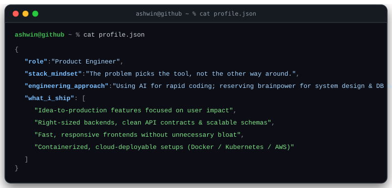
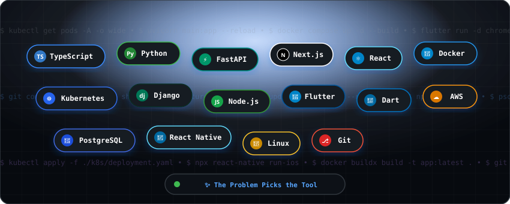

  <h1>Hi, I'm Ashwin 👋</h1>
  
<b>Product Engineer</b>

   

  <!-- Terminal Window SVG -->
  

 

### 🧠 How I Build

<table width="100%">
  <tr>
    <td width="50%" valign="top">
      <h4>⚡ High-Speed Execution</h4>
      
AI accelerates syntax and boilerplate so momentum stays uninterrupted.

    </td>
    <td width="50%" valign="top">
      <h4>📐 Deliberate Architecture</h4>
      
Human brainpower reserved for schema modeling, edge cases, and reliable system flow.

    </td>
  </tr>
  <tr>
    <td width="50%" valign="top">
      <h4>🎯 Right-Sized Solutions</h4>
      
No premature complexity. Pragmatic architectures tailored to the actual problem.

    </td>
    <td width="50%" valign="top">
      <h4>☁️ Cloud &amp; Deployment Fluent</h4>
      
Comfortable shipping with Docker, Kubernetes, Linux environments, CI/CD, and AWS primitives.

    </td>
  </tr>
</table>

 

### 💻 In My Terminal

  

